<p align="center">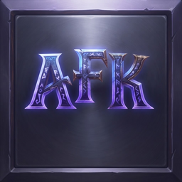</p>

<p align="center"><b>English</b> · <a href="README.de.md">Deutsch</a> · <a href="README.fr.md">Français</a> · <a href="README.es.md">Español</a> · <a href="README.pt-BR.md">Português (Brasil)</a> · <a href="README.ru.md">Русский</a> · <a href="README.zh-Hans.md">简体中文</a></p>

# AFK Realm

*Go AFK, come back to your own server.*

> [!WARNING]
> **Work in progress and highly experimental.** AFK Realm is unfinished and changes all the time. Every release and every new function has to be seen as experimental. New features are often tested on only one PC before they are published, so it is very likely that one thing or another does not work properly yet. Keep backups of anything you care about (AFK Realm makes one before every update and module change), and if something breaks, please report it with `logs\install.log` attached.

Build, run and tweak your own **Conquest of Azeroth** server (an AzerothCore fork with Playerbots) on Windows 10/11 or Linux, compiled straight from source, all through a point-and-click interface.

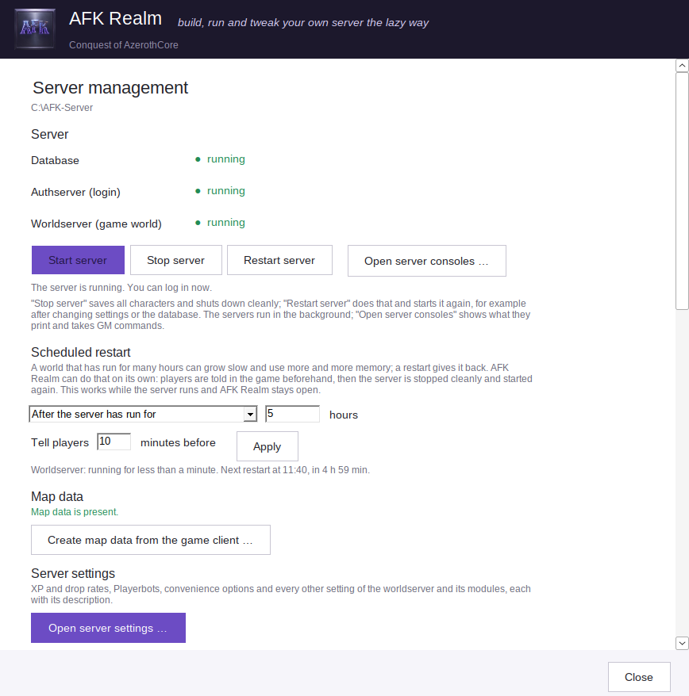

📖 **[User guide](docs/MANUAL.md)** – every window explained: what it is for, when you need it and how to use it.

## About this project

AFK Realm was never planned as a product. I built it for myself: it started as a simple Bash script that compiled my own server, turned into a PowerShell script when the steps piled up, and then got a window on top because I was tired of typing. Since then it keeps growing with whatever I need next for my own server – settings, backups, modules, game master tools.

I'm happy if it is useful to other people too. If something does not work, if something is missing or if you have an idea for what could be better, please tell me: open an [issue](../../issues) or write to me on Discord. Suggestions are very welcome, and a `logs\install.log` makes bug reports much easier to fix.

## Why

Pre-built repacks go stale quickly. Building from source keeps you on the latest fixes, but it needs Git, CMake, Visual Studio, OpenSSL, Boost, MySQL and a lot of patience. This tool does all of that for you and then helps you run the server day to day.

## Features

- **In your language**: English, Deutsch, Français, Español, Português (Brasil), Русский and 简体中文, chosen from Windows or with one click; more languages can be added as a file ([how](docs/MANUAL.md#15-languages))
- **Guided installation**: pick a folder and a database password, then click *Install*
- **Automatic dependencies**: Git, CMake, Visual Studio 2022 C++ Build Tools, OpenSSL 3, Boost 1.87, portable MySQL 8.4, Python and mpqcli, with checksums verified
- **Always current**: every installation builds the newest CoA core and Playerbots
- **Clear progress**: every step, download percentages, compiled files and imported world tables, plus an optional live log
- **Databases ready before the first start**: imports the CoA world package, creates the auth and character databases and applies all SQL updates, and repairs databases whose setup was interrupted
- **A clean interface**: a side bar for the parts of the server, the state of the server and its main buttons always at the top, switches and sliders in AFK Realm's colours
- **Server management**: start, stop and restart (clean shutdown that saves all characters), live status, both server consoles in one window (output of worldserver and authserver, with a command line for GM commands) instead of separate console windows, and the reason shown right away if a server closes while starting
- **Scheduled restart**: the server restarts on its own after a number of hours, every day at a set time or when the worldserver uses too much memory – players are told in the game beforehand, and the page shows uptime, memory and when the next restart is due
- **Server settings**: a list of popular options (XP, drop and reputation rates, flight paths, cross-faction play, Playerbots count and levels) plus every option of the worldserver and all module configs, searchable, with the description from each template and one-click reset to the default
- **Bots**: how many random bots there are and how many are in the world, the players beside them, their average level and the balance of Alliance and Horde, and the bots by class, race, level band and zone as bars – refreshed every 30 seconds while the page is open
- **Accounts**: create accounts with GM levels, list all player accounts (bot accounts are filtered out) with their characters, delete accounts, set new passwords and change access levels
- **Account transfer**: export an account with all its characters, items, mail and pets to an `.afkaccount` file and import it on another server – ids are renumbered, taken names are renamed at the next login
- **Game master tools**: a line to the running server (its SOAP service, switched on for this PC only) with a quest helper – see a character's quest log with the progress of every objective, find quests by NPC name, quest title or id, or list the new quests around a character, then give, complete, reward or remove them with one click – plus unstuck, revive, level, rename, gold and mail for a character, announcements, and a console for every other GM command
- **Database editor**: browse and edit every table of the server and run any SQL without a separate program, import SQL files (it says what a file will do before it runs) and export tables or whole databases by ticking them – read-only until you allow changes, with a clear warning, a one-click backup of the whole server and an "Undo last change" button for edits, SQL statements and imports
- **Modules**: modules made for this server at the top ("Modules by AFK Realm": the bots use the auction house like players; World Journey makes the old world, Outland and Northrend one journey from 1 to 60; the classic classes are played next to the classes of CoA), then the AzerothCore module catalog: browse it, tick modules to install them and untick them to remove them. Before installing, each module is checked (database changes, settings, core patches, client files, age) and its README is one click away. The server is backed up and rebuilt; if a module does not compile, it is taken out again and the server stays as it was. The database changes of every module installed this way are recorded, so removing it undoes them
- **Setup pages for the modules by AFK Realm**: World Journey, the auction house bots and the classic classes each get a page of their own with sliders, switches and previews (where each part of the world begins, every zone with its level, the level window, difficulty presets with an "Extra hard" switch for CoA's own creature multipliers; trips, prices, crafting, chat and the Trading Post of the bots) - shown only when the module is installed, and writing the same .conf file you can still edit by hand. Custom races can download every ZIP of the newest CoA Custom release, extract them together and open the race selection.
- **The game client**: use your existing client, or download/update the complete client from the public CoA development launcher (about 43 GB, resumable, every file checked by SHA-256). Add-ons that modules bring for the game are put into your game folder, and modules that change files of the game get one client patch (`Data\patch-ZZZZZ.MPQ`), built from your own game client; both are kept up to date and taken out with their module, the game's cache is cleared when a module needs it, and "Export as ZIP" packs everything for other players. CoA Custom's loading screens are added by the custom-races module when a CoA client is chosen; a stock client keeps the original WoW screens.
  Custom races can also download every ZIP of the newest CoA Custom release, extract them together and open the race selection. The common CoA Custom source-row IDs are listed in [docs/RACE-IDS.md](docs/RACE-IDS.md); the authoritative table for the current client is **Custom races → Show race IDs**.
- **New bots when a module needs them**: a module that changes what the random bots are made of (the classic classes) offers once to make them anew
- **Bot reset**: one click deletes all random bots with their characters, guilds and arena teams (your own characters are kept); new bots are created at the next start
- **Map data**: extracts maps, vmaps, mmaps and the CoA client DBC tables from your game client with one click
- **Server name**: choose the name shown in the realm list during installation and change it later with one click
- **Play with others**: set a VPN or LAN address (e.g. Radmin VPN); the tool configures the realm, the CoA remote-client setting and the Windows Firewall
- **Updates**: shows when newer server code or a newer AFK Realm release is available and installs a new AFK Realm with one click; checks the core, Playerbots and your installed modules, and rebuilds only when something changed
- **Backups and rollback**: before every update the server is saved (programs, settings, all databases and their versions); if a new version causes problems, one click restores the previous state. Backups can also be made by hand; the newest ones are kept — three by default, the number is up to you
- **Portable**: everything lives in one folder; the database runs without a Windows service

## Screenshots

| World Journey setup | Auction house bots setup |
|---|---|
| 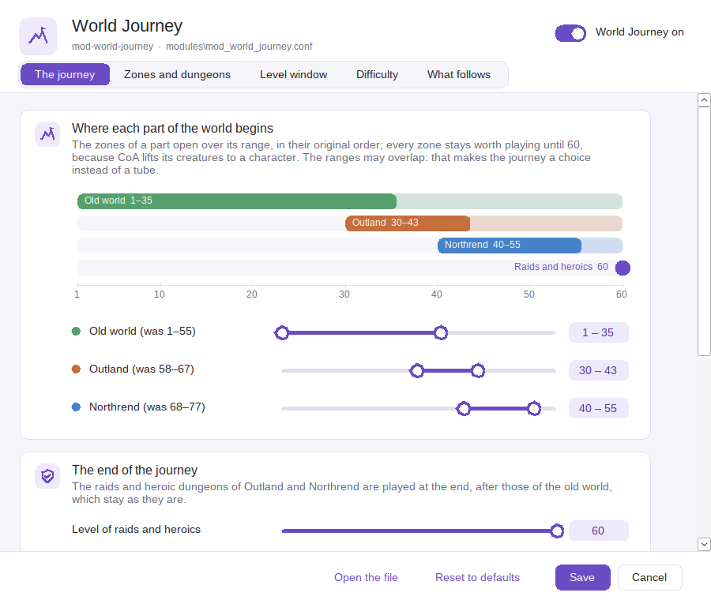 | 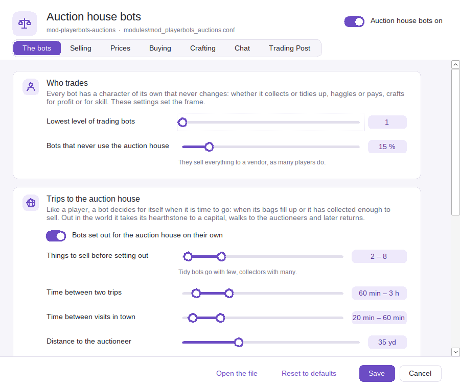 |
| **Modules and their setup pages** | **The game client** |
| 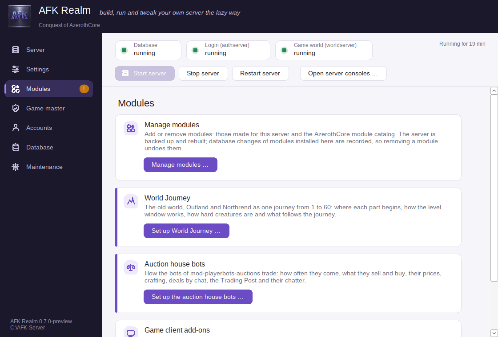 | 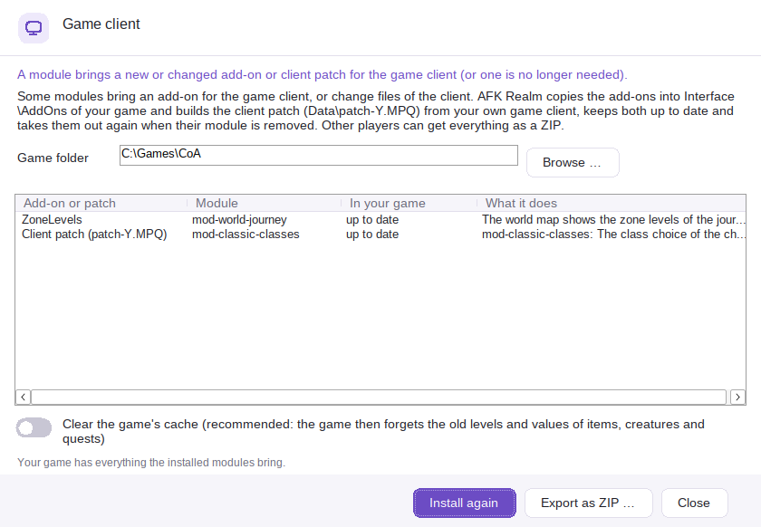 |
| **Bots** | |
|  | |
| **Server settings** | **Player accounts** |
| 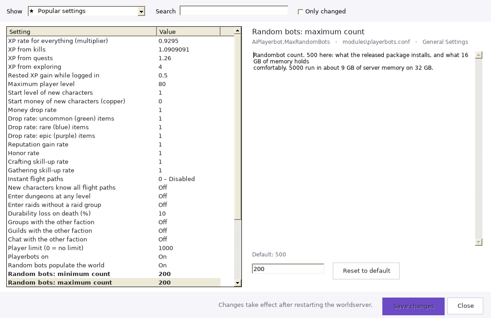 | 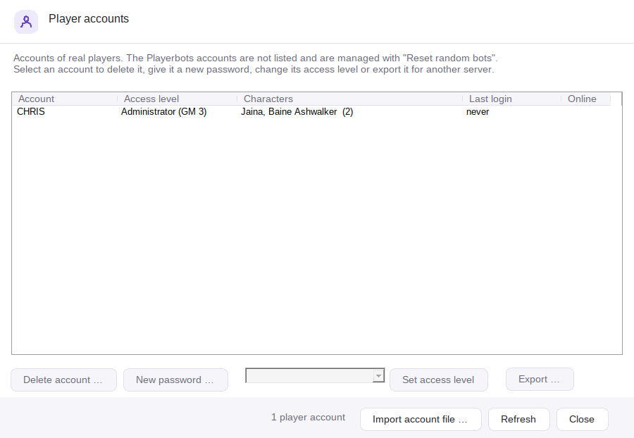 |
| **Backups** | **Update with automatic backup** |
| 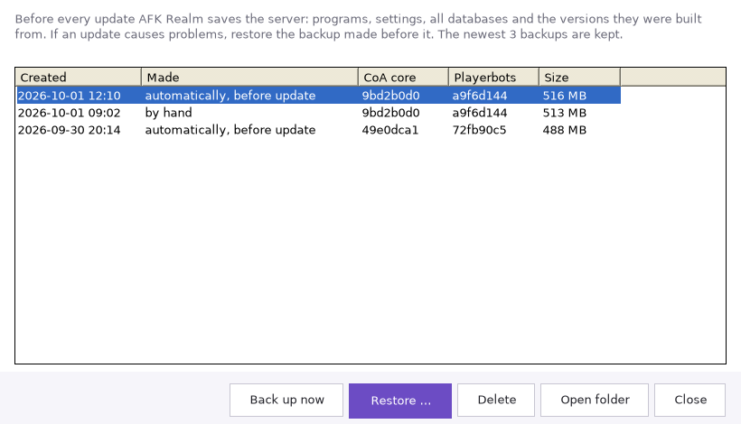 | 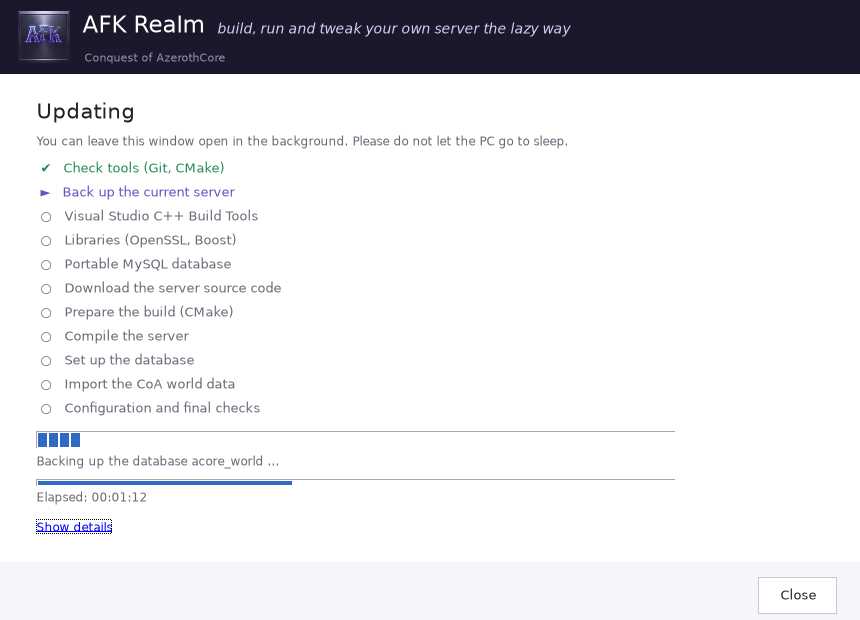 |
| **Game master tools** | **Modules** |
| 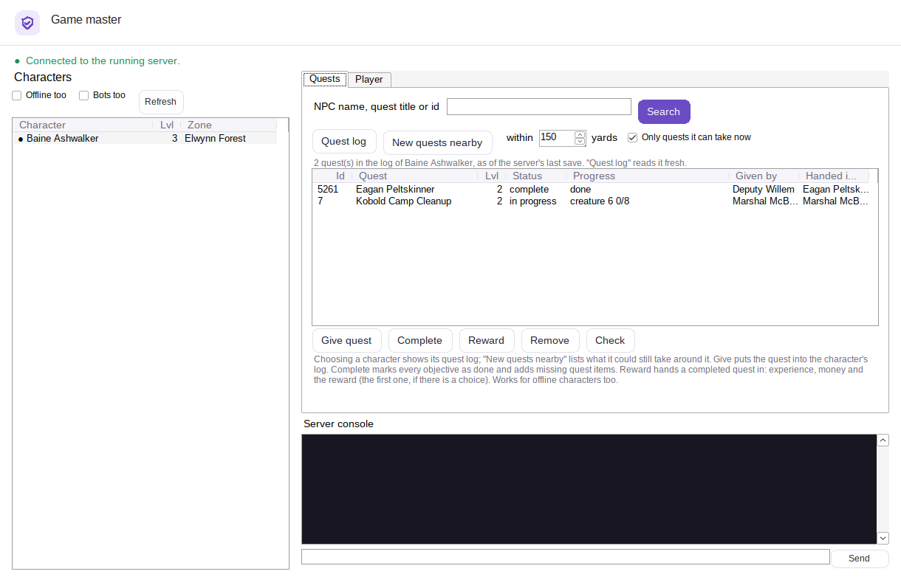 | 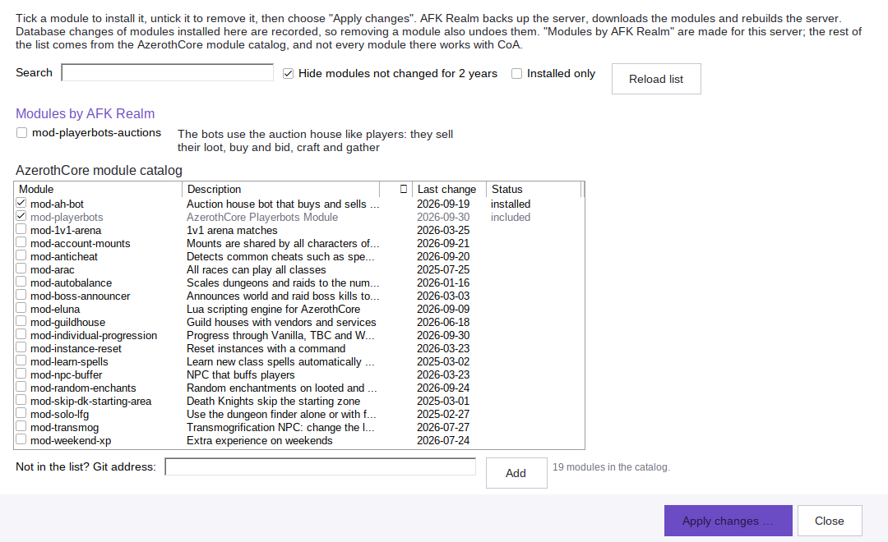 |
| **Installing and removing modules** | **Database editor** |
| 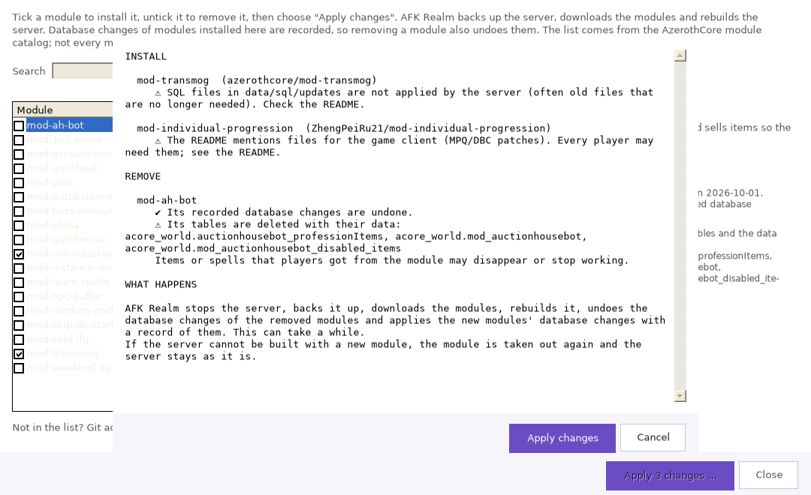 | 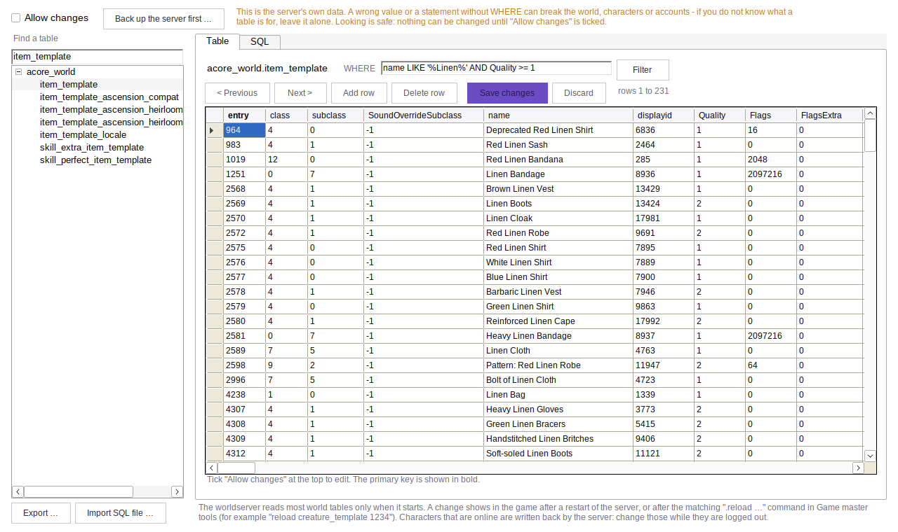 |
| **Installation** | **Progress** |
| 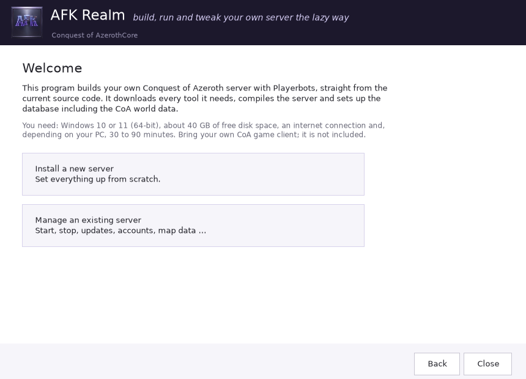 | 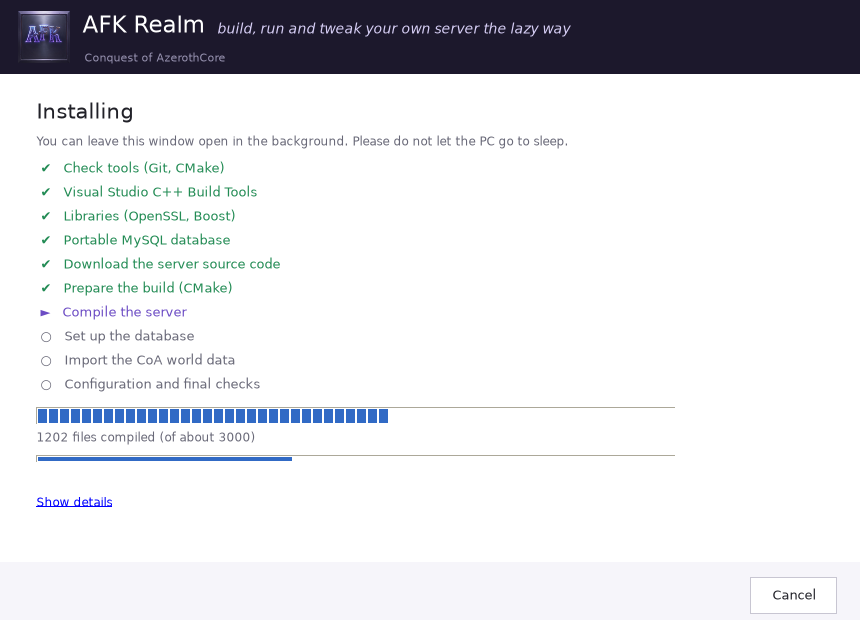 |

## Getting started

The short version is below; the [user guide](docs/MANUAL.md) explains every step and every window in detail.

1. Download `AFK-Realm.exe` from the [Releases](../../releases) page and run it. It opens in an app window of Edge or Chrome (or your browser).
   Windows SmartScreen may warn about an unknown publisher because the exe is not code-signed. The exe is built from this repository by GitHub Actions; you can also build it yourself (see below).
2. **Install a new server** → choose a folder such as `C:\CoA-Server` → set a database password → **Install**.
   The installation may take a long time and needs about 40 GB of disk space.
3. In **Server management**:
   1. *Create map data from the game client* (once; choose the game folder that contains the `Data` folder, and keep the game and its launcher closed)
   2. *Create account*
   3. *Start server*
4. Point your client's `realmlist.wtf` to `set realmlist 127.0.0.1` and log in.

**On Linux:** download `AFK-Realm-linux-x64` (`AFK-Realm-linux-arm64` for ARM) from the [Releases](../../releases) page, run `chmod +x AFK-Realm-linux-x64` once and start it with `./AFK-Realm-linux-x64`. It opens in an app window or your browser and works like the Windows version; if build tools are missing, it shows the one command that installs them. Choose a folder in your home folder without spaces, e.g. `~/CoA-Server`.

You need the CoA game client yourself, or let **Game client → Download client …** fetch the public CoA client for you. The client data is not part of this project; its own terms apply.

## How it works

The window is a small WinForms app (C# 5, .NET Framework 4.x, which is already part of Windows 10/11, no extra runtime needed). All the actual work is done by [`engine/engine.ps1`](engine/engine.ps1), a PowerShell script embedded in the exe. The script works on its own as well:

```powershell
# interactive
powershell -ExecutionPolicy Bypass -File engine\engine.ps1 -InstallRoot C:\CoA-Server
# unattended (modes: Install, Update, Rebuild, Setup, Backup, Restore, Modules)
$env:AC_DB_PASSWORD = '...'
powershell -ExecutionPolicy Bypass -File engine\engine.ps1 -InstallRoot C:\CoA-Server -NonInteractive -Mode Update
```

Sources used:

| Component | Repository | Branch |
|---|---|---|
| Core | [Conquest-of-AzerothCore/azerothcore-wotlk-coa](https://github.com/Conquest-of-AzerothCore/azerothcore-wotlk-coa) | `main` |
| Playerbots | [Zyth45/mod-playerbots](https://github.com/Zyth45/mod-playerbots) | `coa` |
| MPQ reader | [TheGrayDot/mpqcli](https://github.com/TheGrayDot/mpqcli) | release v0.9.9 |

Every installation and rebuild uses the newest commits of the CoA core and Playerbots; *Update* checks for newer ones later. The exact revisions built are recorded in `Dependencies\revisions.txt` and in the install log.

### Game master tools

When the server is started through AFK Realm, the worldserver's SOAP service is switched on (`SOAP.Enabled = 1`, bound to `127.0.0.1`) and an administrator account `AFKREALMADMIN` with a random password is created for it (the password is kept in `Dependencies\admin-link.txt`). The game master window sends GM commands over that line exactly as the server window would, and reads characters, quests and quest givers from the server's own databases – so everything matches CoA's changed world, unlike online databases.

### Modules and their database changes

Modules installed through *Manage modules* are cloned into `Dependencies\Source\modules`. Their SQL files (`data/sql/db-world`, `db-characters`, `db-auth`) are not left to the core's updater: AFK Realm applies them itself, copies the tables they name beforehand and stores the differences (added, changed and removed rows, new and deleted tables) in the database `afk_modules`, which is part of every backup. The files are then entered into the core's `updates` tables with the core's own hash, so they are never applied twice. Removing the module puts every recorded row and table back, but only rows that still look exactly as the module left them; rows changed later (for example by a server update) are kept and listed in the log. Changes that cannot be recorded (a module that alters the structure of an existing table, or changes tables in other ways) are reported; a backup from before the module restores them. Data players created through a module (items in bags, learned spells) is not tracked.

### What a module can bring along

A module can carry a file `afk-realm.json` in its folder. It names patches for the CoA core or for Playerbots – the two source trees AFK Realm downloads itself and resets with every update – and settings the module needs in other config files:

```json
{
  "patches":  [ { "name": "Bots keep their bags", "target": "mod-playerbots", "file": "patches/mod-playerbots/keep-bags-on-refresh.patch", "why": "..." } ],
  "settings": [ { "file": "playerbots.conf", "key": "AiPlayerbot.LootDistance", "value": "40.0", "why": "..." } ],
  "client":   { "addons": [ "client/AddOns/ZoneLevels" ], "clearCache": true, "why": "...",
                "patch": { "files": [ { "from": "client/ClassicClasses.lua", "to": "Interface\\GlueXML\\ClassicClasses.lua" } ],
                           "edits": [ { "file": "Interface\\GlueXML\\GlueXML.toc", "insertAfter": "CharacterCreate.xml", "line": "ClassicClasses.lua" } ] } },
  "bots":     { "reset": true, "why": "..." }
}
```

Before every build both trees are reset and the patches of all installed modules are applied with `git apply`. A patch that no longer fits is left out and reported, one whose change is already in the source is skipped silently; the build goes on either way. Settings are written once, when the module is new, together with the value that was there before (`Dependencies\module-settings.txt`); when the module is removed, a value that is still the module's goes back. `target` is `core` or `mod-playerbots`, nothing else.

`client` names add-ons for the game client: folders inside the module, each with a `.toc` of the same name. AFK Realm copies them into `Interface\AddOns` of the game folder the user chose (*Game client add-ons*), deletes the game's `Cache` folder when `clearCache` is true and an add-on is new or changed, and takes an add-on out again when its module is removed (recorded in `Dependencies\client-addons.txt`). Nothing is copied while a program from the game folder runs. *Export as ZIP* packs the add-ons with a note for other players.

`client.patch` changes files of the game client. `files` are files of the module that go into the game (under `Interface\` or `DBFilesClient\`); a file can take values of server settings (`fill`, one or a list: the line with `marker` becomes `line`, with `{set}` replaced by the numbers of the setting as a Lua set, `{words}` by its words as a Lua list, `{text}` by the setting itself). A file or edit with `when` is only used when its conditions on server settings hold (`{conf, key, default}` with `has`: the setting lists a word, `in`/`notIn`: it is (not) one of a list, `is`: it is a word), and a number in an edit can come from a setting (`{"setting": key, "conf": file, "default": n}`, a text with `"text": true`). An edit or a fill with `forEach` (`{conf, key}`) stands for one per word of that setting, with `{each}` replaced by the word everywhere in it; in a fill line, `{conf:KEY}` is the value of setting KEY. `edits` change files of the game itself, which AFK Realm reads out of the player's own game archives (the one the game reads last wins): `insertAfter` adds a `line` to a text file after the line named, `dropRows` removes the rows of a DBC table whose `field` holds one of `values` and whose id is below `idBelow`, `addRows` adds every combination of the value lists in `cross` (one list per field) the table lacks, in the table's own field width, and stops at `maxRows` rows in all or `maxPerRace` rows with the same first field; `setRows` gives the rows whose fields in `match` (field number: value) hold those values the values in `set` (a value in quotes is a text, added to the table's strings); `copyRows` copies such rows with the fields in `set` changed (`newId`: a new id after the highest; `idGroup` with `idKey`: the same new ids in every table of the group, for tables that pair by id such as CharSections and HDCharSections; skipped when a row agrees in the `key` fields); `fillRows` fills rows whose numbers in `empty` are all 0 or below with the bytes in `copy` of a row that agrees at the `same` offsets (first one whose byte at `prefer.offset` is in the same of `prefer.groups`); `cloneRows` copies the rows whose bytes at the offsets in `match` hold those values, with the bytes in `set` changed and a new id, unless a row with the same bytes at the `key` offsets exists (with `replace`, that row takes the copy's bytes). The patches of all modules go into one archive, `Data\patch-Y.MPQ`, with a stamp of its contents; it is built anew when the result would differ, and removed when no module needs it (`Dependencies\client-patch.txt`). A module that writes rows while the server runs, which the record of its database changes cannot see, brings SQL that takes them back in `data/sql/remove/db-world` (or `db-characters`, `db-auth`); AFK Realm runs it when the module is removed, before it undoes the recorded changes. `bots.reset` makes AFK Realm offer once, after the module came, to make the random bots anew (`Dependencies\bot-reset-offered.txt`).

`lang/<code>.json` (for example `lang/de.json`) carries the module's texts in another language: the same format as AFK Realm's own language files (`{"code": "de", "name": "Deutsch", "strings": {"English text": "translation", …}}`), with the English text as the key. AFK Realm shows the translation of a `name` or `why` of `afk-realm.json`, of the sections, descriptions and choices of the module's `conf/*.conf.dist` (as AFK Realm reads them, so take the keys from `python3 tools/lang.py --module <folder> keys`, which writes `lang/template.json`), of the races of `races.json` and of the zone names of `data/journey-ui.json`. `tools/lang.py --module <folder> check` lists what is missing.

Folder layout after installation:

```
C:\CoA-Server\
  Server\         authserver, worldserver, configs, Data (map data)
  DB\             portable MySQL and its data
  Dependencies\   tools, source code (modules in Source\modules), build files
  logs\           install.log, mysql-error.log
  Backups\        server backups made before updates (the newest ones; 3 by default)
  Builder\        copy of the builder (the desktop shortcut points here)
```

## Troubleshooting

- **Something failed**: the error is shown in the window; the full log is `logs\install.log`. *Try again* continues where it stopped.
- **Visual Studio installation fails**: restart Windows (a pending restart is the most common cause), then try again.
- **Compiler runs out of memory** (errors C1076/C3859): the builder retries automatically with less parallelism; closing games and browsers helps.
- **Worldserver closes with "DataDir does not hold the CoA client DBC set"**: open *Create map data*, choose your CoA game folder and tick *Only refresh the CoA DBC tables*. The stock map extractor cannot read CoA's own patch archives, so the tool extracts these tables with the fork's `apps/coa-dbc/client_dbc.py`.
- **Black screen at the realm selection**: the core is too old for the client's realm cards; run *Check for updates and install*.
- **A module does not compile**: it was taken out again automatically and the server is unchanged; the first compiler error in `logs\install.log` names the problem. Many modules are written for the regular AzerothCore and do not fit CoA.
- **Game master tools say "Stop and start the server once"**: the line to the server is set up when the server is started through AFK Realm; a server that was started earlier or with `START-SERVER.cmd` before the first such start does not have it yet.
- **Friends cannot connect**: set the realm address under *Play with others*, restart the server, and make sure the VPN is connected on both PCs.

## Translations

The texts of AFK Realm are written in English in the code (`L.T("…")`) and translated in `lang/<code>.json`, which are built into the exe. `python3 tools/lang.py keys` writes `lang/template.json` with every text, `python3 tools/lang.py check` shows for each language what is missing, no longer used or has different `{0}` places. Corrections and new languages are welcome as a pull request.

## Building the exe yourself

- AFK Realm (Windows and Linux, web interface) is in `app/`: `dotnet publish app/AfkRealm.csproj -c Release -r win-x64 --self-contained true -p:PublishSingleFile=true` (`-r linux-x64` for Linux; needs the .NET 8 SDK).
- The classic Windows version (WinForms, up to 1.1.5) is no longer released; `build.bat` / `build.sh` (needs `mono-devel`) still build it from `src/`. A classic exe that finds the update notice of 1.1.6 or newer updates itself to the web version.

## Disclaimer

This is an unofficial community tool. It is not affiliated with or endorsed by Blizzard Entertainment, Project Ascension, the AzerothCore project or the authors of the forks it builds. World of Warcraft is a trademark of Blizzard Entertainment. The tool downloads source code from the repositories listed above; their licenses apply to that code. The optional game-client download fetches the public CoA development launcher's client data from its own server; that data is not covered by this project's license and its own terms apply.

## License

MIT (see [LICENSE](LICENSE)) for the code in this repository.
